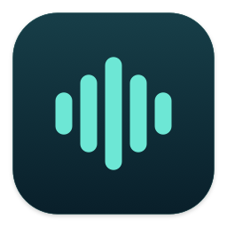

  
  <h1>Robey Voice</h1>
  
A personal macOS dictation fork of VoiceInk

Robey Voice is Jason Robey's GPLv3 fork of [VoiceInk](https://github.com/Beingpax/VoiceInk), by Prakash Joshi (Beingpax) and contributors. The first fork version is **0.1.0**. It removes the application's trial, license activation, purchase prompts, and commercial device limits in every build configuration.

Local dictation requires no app account, license key, subscription, or cloud API credentials. Install a local speech model before using it offline. Cloud transcription, AI enhancement, Ollama, Local CLI, and custom commands remain optional; deliberately configured external services can have their own costs and data handling.

## Features

- Local speech transcription and audio-file transcription using the existing recording and delivery pipeline.
- Configurable recording shortcuts, modes, personal dictionary, and text replacements.
- Separate Robey Voice storage and device-local Keychain credentials; development builds have their own identity too.
- Enhancement, clipboard/selected-text/screen context, and automatic correction observation off in fresh defaults.
- Manual app replacement for updates, with no upstream update feed, announcement service, or CloudKit synchronization.
- About & Licenses information with original authorship, GPLv3, dependency notices, and model provenance.

VoiceInk Refine is unavailable in this fork because its separately licensed, pinned model restricts use in other software. Plain local dictation and permitted optional enhancement providers remain available. See the [model notices](VoiceInk/Resources/Legal/THIRD_PARTY_NOTICES.md).

## Get Started

The initial build target is **Apple silicon with macOS 15 or later**. Intel is unverified. Apple Speech additionally requires macOS 26 or later; other model and provider requirements vary.

Download the **[Robey Voice 0.1.0 preview](https://github.com/GrillerGeek/VoiceInkGG/releases/tag/v0.1.0)**, including the DMG, matching source archive, provenance and checksums. This Apple Development-signed build is **not notarized** and installation on another Mac remains unverified. Read the [release notes](docs/robey-voice-release-0.1.0.md) and [installation and rollback runbook](docs/robey-voice-installation.md) before installing.

You can also build from this checkout using [BUILDING.md](BUILDING.md). There is no Robey Voice Homebrew cask; the upstream VoiceInk download and cask install the upstream application.

The [validation record](docs/robey-voice-validation.md) records the latest signed Release build and all 22 passing acceptance checks, including model-file validation and setup readiness across restart. Earlier builds completed actual Apple Speech and Whisper file transcription with history persistence. Native review of the latest model-setup corrections, owner permission onboarding, live dictation, and second-Mac checks remain pending. The local review package is in `.review-build/review-package/`; this Apple Development-signed build is not notarized.

## Data and Settings

Robey Voice does not automatically import, move, or delete VoiceInk data. Use Settings to export a versioned JSON backup and explicitly select import categories on the destination. New exports omit provider API keys; settings transfer does not include history, recordings, model weights, or macOS permission grants. See the [transfer procedure](docs/robey-voice-installation.md#transfer-settings).

## Documentation

- [Building from Source](BUILDING.md)
- [Installation, Settings Transfer, and Rollback](docs/robey-voice-installation.md)
- [Validation Record and Review Checklist](docs/robey-voice-validation.md)
- [0.1.0 Preview Release Notes](docs/robey-voice-release-0.1.0.md)
- [Third-Party Notices](THIRD_PARTY_NOTICES.md)
- [Contributing Guidelines](CONTRIBUTING.md)

## License and Acknowledgments

The application is licensed under [GNU GPLv3](LICENSE). Robey Voice modifications and original artwork are by Jason Robey, November 16, 2026. Original VoiceInk copyrights and authorship are preserved. This fork is not an upstream release or an offer of upstream support.

Core technology includes [whisper.cpp](https://github.com/ggml-org/whisper.cpp), [FluidAudio](https://github.com/FluidInference/FluidAudio), and [TranscribeCpp for Swift](https://github.com/Beingpax/Transcribe-cpp-swift). The original bundled Silero VAD detector is retained with its MIT license and exact provenance. Transcription and Refine weights are not bundled. Downloaded models retain their own names, licenses, and provenance. The [exact-revision inventory](VoiceInk/Resources/Legal/DEPENDENCY_INVENTORY.md) now verifies all nine resolved Swift packages and the native Whisper dependency; optional model terms remain separate from the application's GPL.
